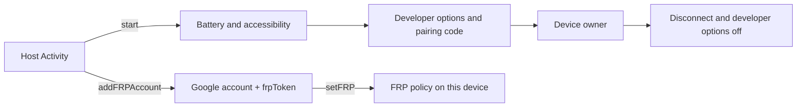

<p align="center">
  
</p>

<p align="center">
  <strong>SELF PROVISIONER JATT SDK</strong><br/>
  <em>Self-provisioning on this device. Your screen. Our session.</em>
</p>

<p align="center">
  
  
  
  
</p>

<p align="center">
  Start from the host Activity. Read the wireless pairing code on this phone.<br/>
  The host app keeps every screen. The SDK shows only system alert dialogs.
</p>

> **Note:** Older versions will be deactivated soon as the SDK is now commercialised, so upgrade to 1.3.0 to avoid deactivation. To get lifetime full access, contact [beastblockstechnologies@gmail.com](mailto:beastblockstechnologies@gmail.com).

---

## What this SDK already does

You do **not** build these in the host app.

| Built in | You never write |
| --- | --- |
| Battery-optimization, accessibility, and developer-option prompts | Host setup wizards |
| Wireless pairing-code read and device-owner setup | ADB shell scripts |
| Developer options and wireless debugging closed after success | Host settings cleanup |
| Step listener (`SelfProvisionerListener`) | Host progress plumbing |
| Accessibility and developer-mode guides | Host instruction screens |
| Device-owner check (`isDeviceOwner`) | Host `DevicePolicyManager` device-owner query |
| FRP (`addFRPAccount` / `setFRP` / `setOrganizationName`) | Host Google sign-in, factory-reset protection, and lock-screen org name |

This SDK provisions **this device**. It does not scan nearby phones, open a pair-code popup, or use QR or USB.

Implementation path: **depend → `start` from an Activity**.



Every snippet is **Kotlin**, then **Java**. The sliding tab matches the block under it.

# Implementation

This section is what you must wire.

## SDK implementation

Open the **root** Gradle settings file. Add Google and Maven Central.

<p>
  
</p>

<p><sub>SETTINGS · SETTINGS.GRADLE.KTS</sub></p>

```kotlin
dependencyResolutionManagement {
    repositoriesMode.set(RepositoriesMode.FAIL_ON_PROJECT_REPOS)
    repositories {
        google()
        mavenCentral()
    }
}
```

<p>
  
</p>

<p><sub>SETTINGS · SETTINGS.GRADLE</sub></p>

```groovy
dependencyResolutionManagement {
    repositoriesMode.set(RepositoriesMode.FAIL_ON_PROJECT_REPOS)
    repositories {
        google()
        mavenCentral()
    }
}
```

In the **app** module, set `minSdk` 26. The SDK’s minimum supported Gradle is **8.13**. Add a single `implementation`. Do not drop a raw AAR into `app/libs/`. Do not re-declare the SDK’s transitive libraries.

<p>
  
</p>

<p><sub>APP · BUILD.GRADLE.KTS</sub></p>

```kotlin
android {
    defaultConfig {
        minSdk = 26 // Gradle 8.13+
    }
}

dependencies {
    implementation("com.beastblocks:self-provisioner-jatt:1.3.0")
}
```

<p>
  
</p>

<p><sub>APP · BUILD.GRADLE</sub></p>

```groovy
android {
    defaultConfig {
        minSdk 26 // Gradle 8.13+
    }
}

dependencies {
    implementation 'com.beastblocks:self-provisioner-jatt:1.3.0'
}
```

`INTERNET` and the other SDK permissions **merge from the AAR**.

The sample module is `:sample`. It uses the same screen layout as the Provisioner Jatt example: this logo, a title, and full-width actions.

---

## Start from an Activity

Call `SelfProvisionerJatt.start` from an Activity. Do **not** call it from `Application`. Calling it again on the same screen replaces the previous run and begins again at the battery-optimization check.

If this app is already device owner, `start` shows a toast and does not continue. If another app is already device owner, `start` shows a toast that the device must be factory reset before self-provisioning can run again.

`SelfProvisionerOptions.automate` defaults to `false`. When `true`, accessibility opens developer options and the wireless pairing-code screen. When `false`, those two steps are skipped and the service only reads a pairing code the user opens manually.

<p>
  
</p>

<p><sub>ACTIVITY · START</sub></p>

```kotlin
import com.beastblocks.selfprovisionerjatt.SelfProvisionerJatt
import com.beastblocks.selfprovisionerjatt.SelfProvisionerOptions

SelfProvisionerJatt.start(
    this,
    { step ->
        val line = "${step.position}/${step.total} ${step.phase}: ${step.message}"
    },
    SelfProvisionerOptions(automate = false),
)
```

<p>
  
</p>

<p><sub>ACTIVITY · START</sub></p>

```java
import com.beastblocks.selfprovisionerjatt.SelfProvisionerJatt;
import com.beastblocks.selfprovisionerjatt.SelfProvisionerOptions;

SelfProvisionerJatt.start(
    this,
    step -> {
        String line = step.getPosition() + "/" + step.getTotal()
            + " " + step.getPhase() + ": " + step.getMessage();
    },
    new SelfProvisionerOptions(false)
);
```

| Parameter | Default | Purpose |
| --- | --- | --- |
| `listener` | required | Receives every step with its position, phase, message, and success flag |
| `options.automate` | `false` | `true` opens developer options and the wireless pairing-code screen through accessibility |

---

## Exposed functions

<p>
  
</p>

<p><sub>CLIENT · KOTLIN</sub></p>

```kotlin
SelfProvisionerJatt.start(this, listener, SelfProvisionerOptions(automate = false))
SelfProvisionerJatt.openAccessibilityGuide(this)
SelfProvisionerJatt.openDeveloperModeGuide(this)
SelfProvisionerJatt.isDeviceOwner(this)

SelfProvisionerJatt.addFRPAccount(this, { result -> /* name, email, frpToken or reason */ }, getString(R.string.default_web_client_id))
SelfProvisionerJatt.setFRP(frpToken, this)
SelfProvisionerJatt.setOrganizationName("Acme", this)
```

<p>
  
</p>

<p><sub>CLIENT · JAVA</sub></p>

```java
SelfProvisionerJatt.start(this, listener, new SelfProvisionerOptions(false));
SelfProvisionerJatt.openAccessibilityGuide(this);
SelfProvisionerJatt.openDeveloperModeGuide(this);
boolean deviceOwner = SelfProvisionerJatt.isDeviceOwner(this);

SelfProvisionerJatt.addFRPAccount(this, result -> { /* name, email, frpToken or reason */ }, getString(R.string.default_web_client_id));
FrpSetResult applied = SelfProvisionerJatt.setFRP(frpToken, this);
FrpSetResult org = SelfProvisionerJatt.setOrganizationName("Acme", this);
```

### `isDeviceOwner` — this app as device owner

**Use when:** you need to know whether this app is the device owner of **this** device.

| Result | When |
| --- | --- |
| Returns `true` | This app is device owner of this device |
| Returns `false` | This app is not device owner |

### `addFRPAccount` / `setFRP` / `setOrganizationName`

**Use when:** you need a Google-account FRP token from this app, then later apply that token while this app is device owner. Optionally set the lock-screen organization name on this same device.

**How:** `addFRPAccount(activity, callback, serverClientId)` runs the Google account chooser on that same host activity. The **web** client ID is required on this call. See **Web client ID**. On success the SDK returns `name`, `email`, and `frpToken`. `setFRP(token, context)` applies factory reset protection from that token when this app is device owner. `setOrganizationName(orgName, context)` is a separate call. Blank `orgName` clears the name.

<p>
  
</p>

<p><sub>CLIENT · FRP</sub></p>

```kotlin
SelfProvisionerJatt.addFRPAccount(this, { result ->
    if (result.success) {
        val name = result.name
        val email = result.email
        val frpToken = result.frpToken
    } else {
        val reason = result.reason
    }
}, getString(R.string.default_web_client_id))
val applied = SelfProvisionerJatt.setFRP(frpToken, this)
val org = SelfProvisionerJatt.setOrganizationName("Acme", this)
```

<p>
  
</p>

<p><sub>CLIENT · FRP</sub></p>

```java
SelfProvisionerJatt.addFRPAccount(this, result -> {
    if (result.getSuccess()) {
        String name = result.getName();
        String email = result.getEmail();
        String frpToken = result.getFrpToken();
    } else {
        String reason = result.getReason();
    }
}, getString(R.string.default_web_client_id));
FrpSetResult applied = SelfProvisionerJatt.setFRP(frpToken, this);
FrpSetResult org = SelfProvisionerJatt.setOrganizationName("Acme", this);
```

| Result | When |
| --- | --- |
| `addFRPAccount` `success` | The account chooser returned an account and `frpToken` is ready |
| `addFRPAccount` failure | Missing web client ID, Play services missing, sign-in cancelled or failed, or a sign-in is already running |
| `setFRP` `success` | This app is device owner and factory reset protection was applied from `token` |
| `setFRP` failure | Not device owner, empty or invalid token, no admin, or the system rejected the FRP policy |
| `setOrganizationName` `success` | This app is device owner and `orgName` was written |
| `setOrganizationName` failure | Not device owner, no admin, or the system rejected the change |

### Steps

`SelfProvisionerListener.onStep` reports `position`, `total`, `phase`, `message`, and `success`.

| Phase | When |
| --- | --- |
| `ACCESSIBILITY` | Accessibility service must be enabled, or it has connected |
| `BATTERY_OPTIMIZATION` | Battery optimization must be ignored for this app |
| `DEVELOPER_MODE` | Developer options are being opened or confirmed |
| `WIRELESS_DEBUGGING` | Wireless debugging is being opened |
| `PAIR_CODE` | A wireless pairing code is being read |
| `DEVICE_OWNER` | Device owner is being set |
| `DISCONNECT` | The temporary wireless session is being closed |
| `DEVELOPER_MODE_OFF` | Developer options are being turned off |
| `DONE` | The run finished |
| `FAILED` | The run stopped |

After device owner is set, the accessibility service stops reading the screen.

---

# Features

## Manual pairing code

Leave `automate` at `false`. The user opens developer options and the wireless pairing-code screen. The SDK reads that code and continues.

## Automated developer options

Pass `SelfProvisionerOptions(automate = true)`. Accessibility opens developer options and the wireless pairing-code screen, then the same pairing-code read continues.

## Guides

`openAccessibilityGuide` explains how to allow this app’s accessibility service when the phone blocks it. `openDeveloperModeGuide` explains how to turn on developer options from Settings. Both are system alert dialogs on the Activity you pass.

## Factory reset protection

`addFRPAccount` is the Google sign-in step. Call it from an Activity. `setFRP` is a later step and requires this app to be device owner. `setOrganizationName` is optional and independent of add/set FRP.

---

## Host checklist

- [ ] `minSdk` 26+ · Gradle 8.13+
- [ ] `implementation("com.beastblocks:self-provisioner-jatt:1.3.0")` — one line
- [ ] `google()` and `mavenCentral()`
- [ ] `start` from an Activity, not from `Application`
- [ ] `SelfProvisionerListener` to show step progress
- [ ] Optional: `automate = true` when accessibility should open developer options and the pairing-code screen
- [ ] Optional: `addFRPAccount` / `setFRP` / `setOrganizationName` on this device-owner app. Pass the Google OAuth **web** client ID to `addFRPAccount`. See **Web client ID**

The SDK does not bypass Android enterprise policy. Device owner, factory reset protection, and the organization name still follow this device’s policy.

---

# Web client ID

`addFRPAccount` needs a Google OAuth **Web** client ID as `serverClientId`. That is not an Android client ID. Pass that string as the last argument of `SelfProvisionerJatt.addFRPAccount`. Hosts often keep it in a string resource and pass `getString(R.string.default_web_client_id)`.

Do not use the **Android** OAuth client ID for `serverClientId`.

---

<p align="center">
  
  <br/>
  <sub>Self Provisioner Jatt SDK · v1.3.0 · <code>com.beastblocks.selfprovisionerjatt</code></sub>
</p>
